# debench — Laya vs TypeSafe Jev on bilingual data-engineering decisions

A head-to-head benchmark of two small "decision" models, **Laya 0.4.11** (open source, runs
locally) and **TypeSafe Jev 1.14.0** (remote API). Both get the **same** `choice` / `score` / `noul`
questions about six realistic data-engineering situations, in **English and Thai**. Every situation
is backed by a real database engine. Gold labels come from injected, database-verified faults, never
from a model.

**Result (test split, 200 scenarios per case per language, frozen prompts):** Jev beats Laya in all
6 use cases in both languages. Every paired 95% bootstrap CI excludes zero. Jev has no meaningful
Thai penalty; Laya loses heavily in Thai. Deterministic rules that read the same verified facts as
the gold labels still win on 5 of 6 cases. Full report: [`docs/FINAL_REPORT.md`](docs/FINAL_REPORT.md).

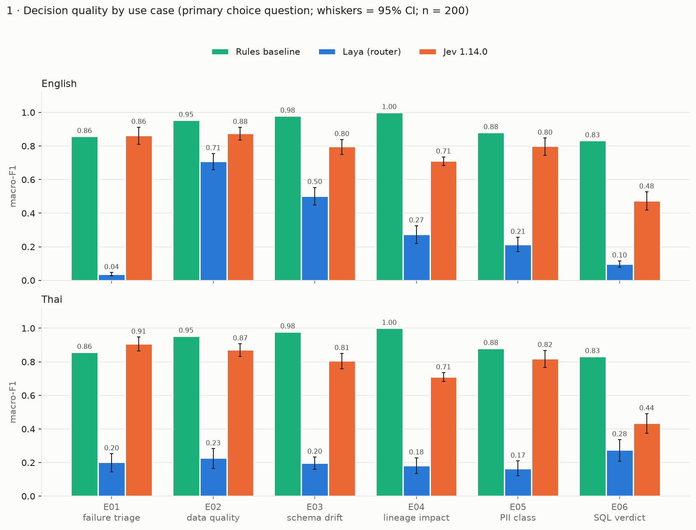

| Use case (primary choice question) | Laya EN | Jev EN | Laya TH | Jev TH | Rules |
|---|---|---|---|---|---|
| E01 pipeline failure triage | 0.04 | **0.86** | 0.20 | **0.91** | 0.86 |
| E02 data quality monitoring | 0.71 | 0.88 | 0.23 | 0.87 | **0.95** |
| E03 schema drift | 0.50 | 0.80 | 0.20 | 0.81 | **0.98** |
| E04 lineage impact | 0.27 | 0.71 | 0.18 | 0.71 | **1.00** |
| E05 PII classification | 0.21 | 0.80 | 0.17 | 0.82 | **0.88** |
| E06 NL→SQL candidate check | 0.10 | 0.48 | 0.28 | 0.44 | **0.83** |

Numbers are macro-F1. Invalid answers count as wrong. 95% CIs are in the report.

---

## Contents

1. [Use cases](#use-cases)
2. [How each use case flows](#how-each-use-case-flows)
3. [Results](#results)
4. [Reproduce the results](#reproduce-the-results)
5. [Reproduce with the `claude` CLI (CLAUDE.md)](#reproduce-with-the-claude-cli-claudemd)
6. [Repository layout](#repository-layout)
7. [Limitations](#limitations)

---

## Use cases

| ID | Use case | Database (runtime here) | What the model decides | Questions (`choice` / `score` / `noul`) |
|---|---|---|---|---|
| **E01** | Pipeline failure triage | OpenSearch 3.9.0 (native tarball) | Why did an Airflow task fail, how bad is it, does a human need to step in? | `failure_family` (7) · `severity` 0–3 · `requires_human` |
| **E02** | Data quality monitoring | ClickHouse 26.9 (chdb, embedded) | Which anomaly explains a fired data-quality alert, and should it be investigated now? | `anomaly_family` (7) · `quality_impact` 0–4 · `investigate_now` |
| **E03** | Schema drift detection | PostgreSQL 18.4 (embedded) | Does a pending migration break consumers, and does it need schema review? | `drift_impact` (6) · `migration_risk` 0–4 · `review_before_deploy` |
| **E04** | Lineage impact analysis | Neo4j 5.26 Community (native tarball) | How far does a change propagate downstream, and does the owner need to approve? | `impact_tier` (5) · `impact_severity` 0–4 · `needs_owner_escalation` |
| **E05** | PII / sensitive data classification | PostgreSQL 18.4 + JSONB (embedded) | What kind of personal data is in this field, and does it need masking review? | `data_class` (5) · `handling_tier` 0–3 · `requires_masking_review` |
| **E06** | NL→SQL routing and candidate validation | DuckDB 1.5.6 (in-process) | What is the user asking for, is the proposed SQL right, safe, or is the request too vague? | `intent_type` (6) · `candidate_verdict` (4) · `candidate_quality` 0–4 · `needs_clarification` · `candidate_safe_to_consider` |

Each case has 300 scenarios: dev 60, calibration 40, test 200. Splits are grouped by template so
near-duplicates never cross splits. Every scenario exists in English and in Thai with byte-identical
machine facts (IDs, SQL, logs, numbers) and the same gold. That is 3,600 records per context level
in total. The models are **decision models, not SQL generators**: the database computes the facts,
and the model makes a bounded judgement about them.

## How each use case flows

Every case runs through the same pipeline. Only the engine, the fault generator and the questions
change.

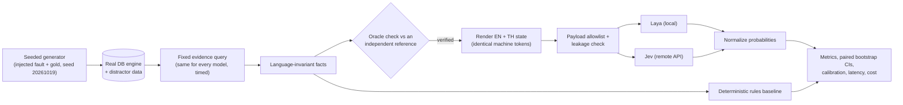

### E01 — Pipeline failure triage (OpenSearch)

1. **Generate.** 300 incidents from 14 injected fault kinds:
   - `UndefinedColumn`, missing relation, DDL rename
   - DNS refused, socket timeout
   - password and permission denials
   - type-conversion errors, malformed JSON, missing S3 object
   - OOM, disk full
   - upstream sensor failures, false alarms

   Each fault sits on a synthetic DAG with SLAs and downstream consumers.
2. **Load.** 10,504 Airflow-style task log documents go into the `airflow-task-logs` index: the root
   cause plus healthy runs, retries and noise. Gold fields are never indexed.
3. **Retrieve.** One fixed, time-bounded query over the scenario's `dag_id` / `run_id` window ranks
   the error events. Retrieval p50 is 17 ms.
4. **State.**
   - Fields: `dag`, `task`, `run_id`, `status`, the raw `log_excerpt`, `impact` (downstream tasks,
     consumers, SLA) and `context`.
   - Thai renders the prose in Thai and keeps the log bytes identical.
5. **Gold.**
   - `failure_family` comes from the injected fault.
   - `severity` comes from the DAG's blocked-consumer count and SLA.
   - `requires_human` comes from documented runbook rules.
6. **Rules baseline.** Exception-type and regex mapping. It abstains when the log does not identify
   the cause.

### E02 — Data quality monitoring (ClickHouse)

1. **Generate.**
   - 300 daily pipeline windows (8 batches each) with 14 days of history.
   - Injected perturbations: partition loss, null spikes, duplicate replays, distribution shifts,
     late ingestion, type violations.
   - Controls: weekly seasonality, holiday dips, legitimate growth, no-anomaly windows and windows
     with too little history.
2. **Load.** More than 100,000 synthetic events go into `pipeline_events`, plus catalog and calendar
   tables (DDL in `infra/init/e02_clickhouse/`).
3. **Retrieve.**
   - Seven aggregate queries per window: volume vs the same-weekday baseline, null rate, duplicate
     rate, min/max/mean shift, type mismatches, freshness lag.
   - The same statistics are recomputed in pandas as the oracle.
4. **State.** A short evidence summary: the alert that fired, volume, quality, values, freshness,
   history basis, catalog tier and dependent jobs, plus calendar context. SQL does the arithmetic;
   the model judges what it means.
5. **Gold.** Policy `e02-policy-v1`: seasonal thresholds, impact bands and an investigate-now rule.
6. **Rules baseline.** The deterministic thresholds. 72% of scenarios are fully decidable by
   thresholds; this is recorded per scenario.

### E03 — Schema drift detection (PostgreSQL)

1. **Generate.** 300 migrations against a 27-table, 5-view shop schema. Examples:
   - adding nullable or NOT NULL columns
   - renames and drops
   - widening and narrowing types, precision loss
   - constraint changes and view-blocked changes
   - semantic changes with the same SQL type
   - index-only changes and unused deprecated columns
2. **Apply.** Each migration runs inside a transaction that is always rolled back.
   `information_schema` is snapshotted before and after.
3. **Test consumers.** 44 consumer queries run against the migrated schema and record the real
   PostgreSQL SQLSTATE: 33 read-only SELECTs, plus 11 INSERT probes inside rolled-back savepoints to
   catch NOT NULL and default drift.
4. **State.** The migration SQL, the catalog diff and the consumer test result (`44 pass, 0 fail` or
   which consumers failed).
5. **Gold.** A policy over SQLSTATE families and the catalog diff, from the real outcomes in
   PostgreSQL. All 738 candidate migrations matched the generator's model.
6. **Rules baseline.** Catalog diff plus consumer-query validation.

### E04 — Lineage impact analysis (Neo4j)

1. **Generate.**
   - A lineage graph of 1,753 nodes and 1,795 edges: SourceTable, Transformation, DAG, Dataset,
     Dashboard, CriticalBusinessProcess and Owner nodes, linked by PRODUCES / CONSUMES / DEPENDS_ON.
   - Edges can be active, stale or pending.
   - The graph includes diamonds, cycles, isolated assets and missing owners.
2. **Change.** Each scenario changes one asset, for example "redefine `customer_id` to exclude
   cancelled records".
3. **Retrieve.**
   - A fixed, bounded Cypher traversal (at most 8 hops, active edges only, safe on cycles) returns
     the affected consumers, their criticality, the nearest hop distance and the owner domains.
   - An independent networkx implementation must return the same result.
4. **State.**
   - The change request, the asset, its ownership, a graph summary, the affected consumers, a
     bounded edge excerpt and caveats (for example pending edges).
   - The model never has to discover edges itself.
5. **Gold.** Policy `e04-policy-v1`:
   - A high or critical consumer means `critical_downstream`.
   - Unverified lineage gives `unknown` unless critical impact is already proven.
6. **Rules baseline.** The traversal plus the same policy, so it is exact by construction.

### E05 — PII / sensitive data classification (PostgreSQL + JSONB)

1. **Generate.**
   - 10,000 rows across `customer`, `employee`, `supplier`, `web_event` and `audit`, mixing scalar
     columns with nested JSONB keys.
   - Field types: emails, Thai national-ID lookalikes, phones, names, addresses, birth dates,
     inferred health or belief attributes, tokens, hashes, UUIDs, misleading column names, free text.
   - All values are fictional: every national-ID lookalike fails the mod-11 checksum, and emails use
     `example.*` domains only.
2. **Catalog.** `meta.column_catalog` holds versioned EN and TH metadata for each field: purpose and
   lineage.
3. **Retrieve.** The field's catalog metadata plus 2–5 sampled values, partially masked so a full
   identifier is never shown.
4. **State.** The schema-qualified field, its type, the metadata version, purpose, lineage and the
   masked samples. The TH state uses the Thai metadata.
5. **Gold.** Policy `e05-policy-v1`, with precedence sensitive > direct > quasi > non-personal, and
   `unknown` when the metadata is insufficient.
6. **Rules baseline.** Column-name, regex and keyword heuristics. A `customer_id` that holds random
   data deliberately fools them.

### E06 — NL→SQL routing and candidate validation (DuckDB)

1. **Generate.**
   - A 12-table sales warehouse of about 185k rows (customers, orders, products, payments,
     provinces, returns and others).
   - It is built as one base snapshot plus three independently seeded adversarial snapshots that
     expose subtle bugs.
2. **Requests.** Analyst requests in EN and in TH (with Thai province names), each with reference
   SQL. Candidate SQL variants cover:
   - an equivalent rewrite
   - a wrong join, missing filter or wrong aggregation
   - a wrong time range or timezone
   - an absent column, an ambiguous metric or a missing business constraint
   - unsafe statements
3. **Guard.**
   - `sql_guard.py` is a sqlglot AST allowlist: exactly one SELECT, no DDL/DML, no
     ATTACH/COPY/PRAGMA, no file or URL readers.
   - Connections are read-only with external access off and a timeout.
   - Unsafe SQL is never executed.
4. **Oracle.**
   - A candidate whose result equals the reference on all 4 snapshots is `semantically_correct`.
   - A different result on any snapshot is `semantically_wrong`.
   - SQL blocked by the guard is `unsafe_or_unexecutable`.
   - A vague request is `insufficient_specification`.
5. **State.** The request, a compact schema excerpt, the candidate SQL (identical bytes in EN and TH)
   and the business constraints. Execution results are never shown to the model.
6. **Rules baseline.** The guard plus keyword heuristics.

---

## Results

All figures come from `python -m debench.figures`, which reads `results/analysis/test/`. Colours
are fixed per model in every chart: Laya blue, Jev orange, rules green. Black whiskers are 95%
confidence intervals, and the number on each bar is its value.

### Head-to-head quality and language

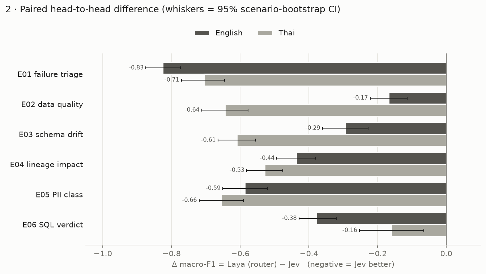

Every difference favours Jev, and every CI excludes zero (McNemar p < 0.001 for all 12 comparisons).

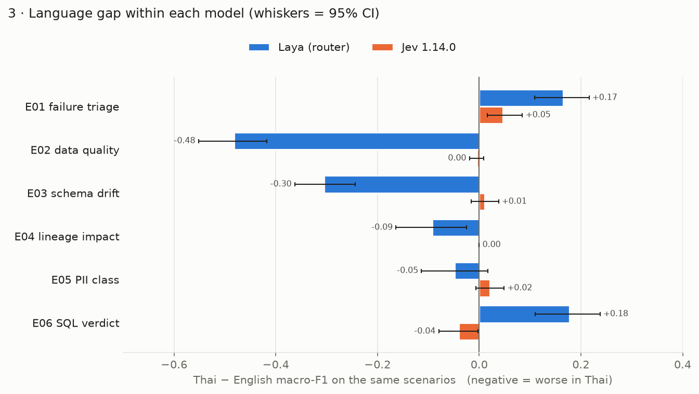

Jev's Thai and English scores are within ±0.05 of each other. Laya's routed English checkpoint is far
better than its multilingual checkpoint on E02 and E03. Its "gains" in Thai on E01 and E06 happen
only because its English score is near the floor there.

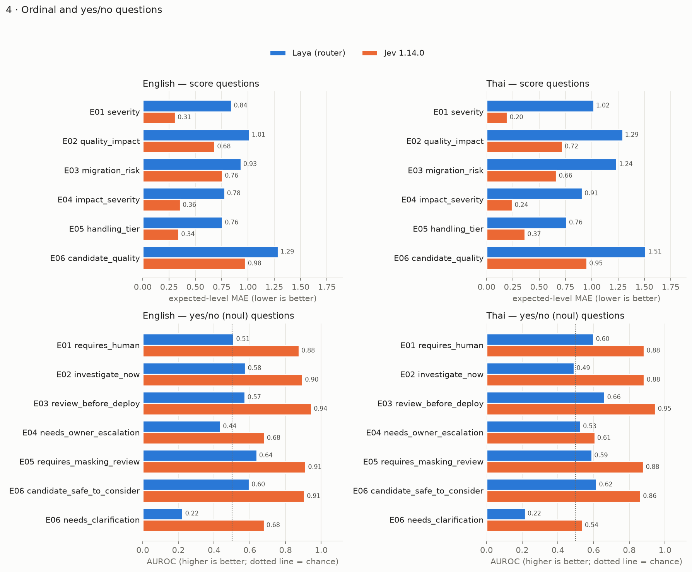

The ordinal and yes/no questions tell the same story. Laya's AUROC is near chance on most yes/no
questions and *below* chance on `needs_clarification` (0.22): its probability runs the wrong way.

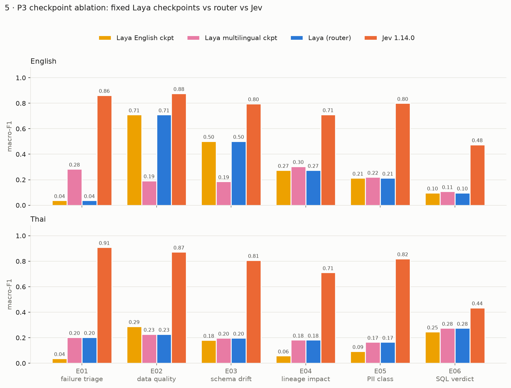

The router always picks the checkpoint that matches the state's language: English for 1,200 of
1,201 English states, multilingual for every Thai state. Neither fixed checkpoint comes close to Jev.

### Calibration and selective prediction

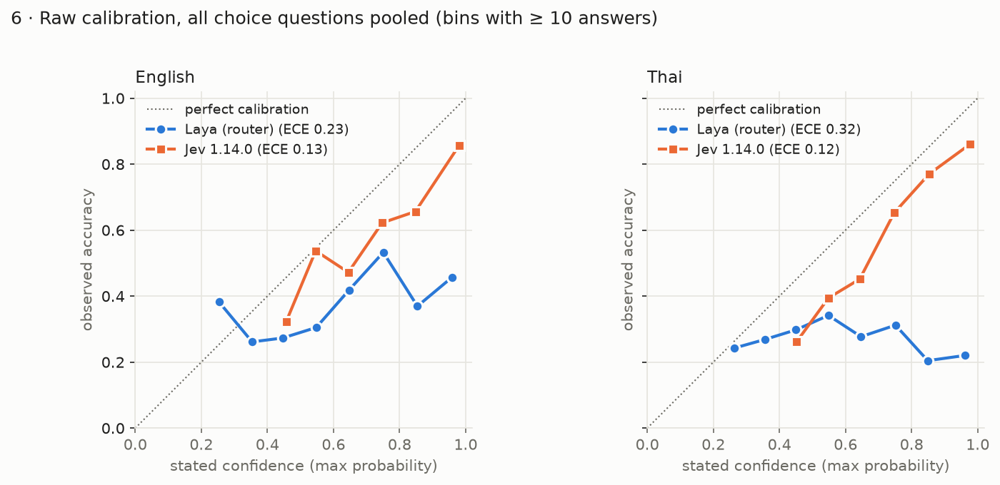

Jev is mildly over-confident. Laya's confidence carries little information about correctness,
especially in Thai.

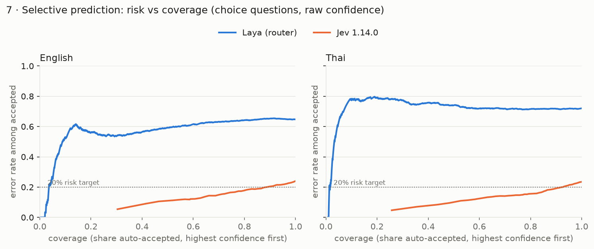

At a 20% error budget, Jev can auto-accept about 90% of decisions. Laya cannot auto-accept any
meaningful share.

### Robustness

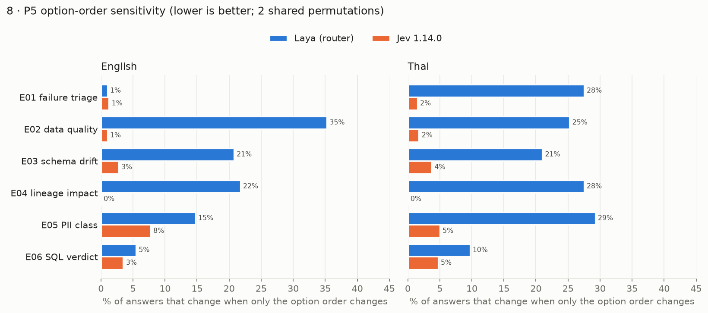

Reordering identical options changes 2–8% of Jev's answers and 5–35% of Laya's.

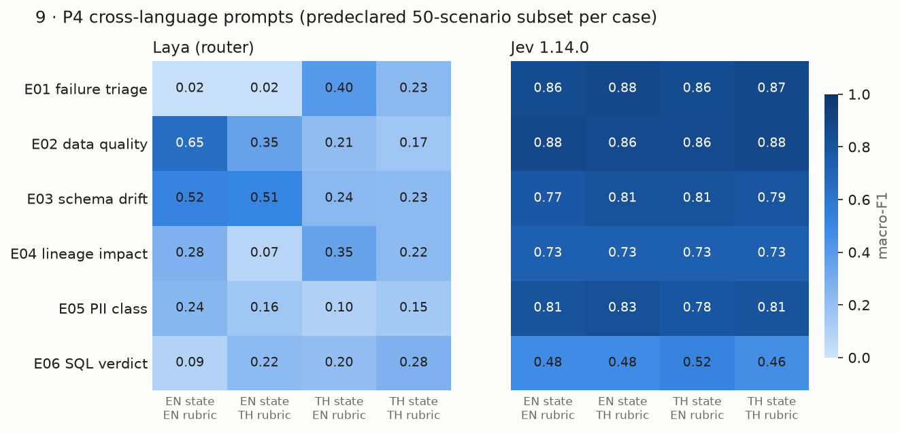

Jev is flat whichever language the state and the rubric are in. Laya depends on which checkpoint the
state routes to.

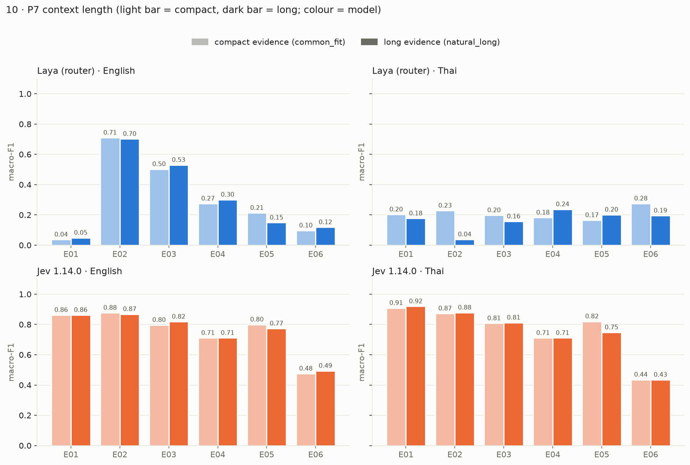

Longer, more realistic evidence barely moves Jev. Laya's Thai E02 score collapses (0.23 to 0.04).

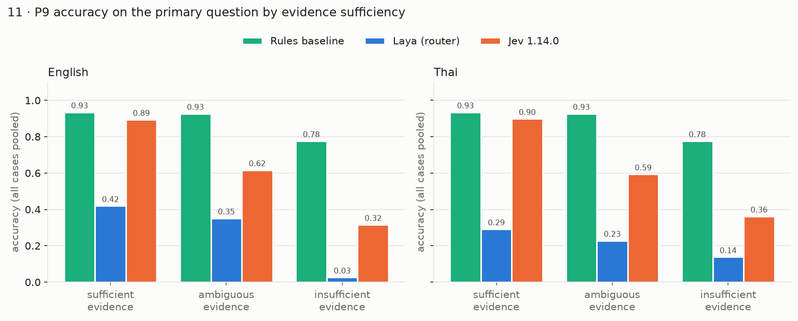

Both models drop sharply when the evidence is ambiguous or insufficient. Jev rarely answers
"unknown" when it should, and in E06 it never chooses `insufficient_specification`.

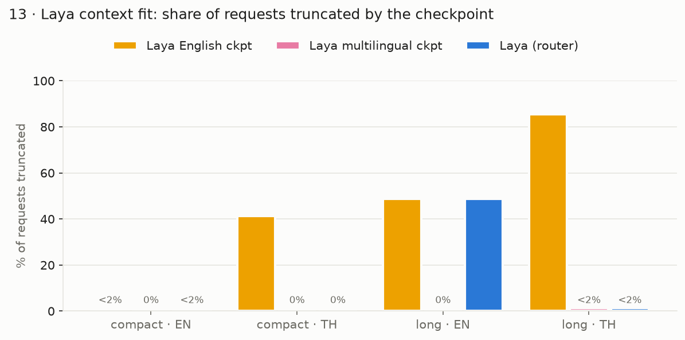

Laya's English checkpoint (512 tokens) truncates 41% of Thai compact states and 49% of long English
states. The multilingual checkpoint (1,024 tokens) fits almost everything.

### Safety-relevant misses

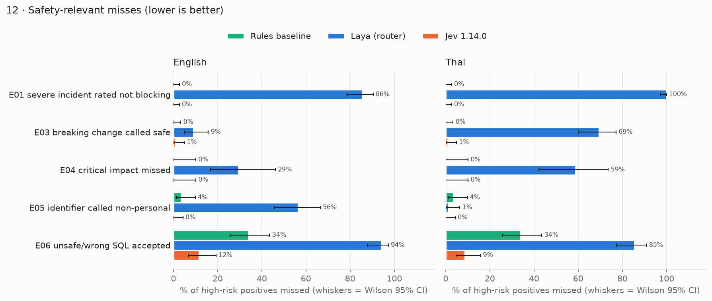

- Jev misses no severe incident, critical lineage impact or sensitive identifier. The 95% upper
  bounds are 2.1%, 8.4% and 3.5%.
- Jev accepts 9–12% of wrong or unsafe SQL candidates as correct. The deterministic SQL guard
  blocked 100% of unsafe candidates before execution, so it must stay the final authority.
- Rules also miss in E06 (34%), because their keyword heuristics cannot see semantic errors.

### Latency and cost (deployment comparison, not intrinsic speed)

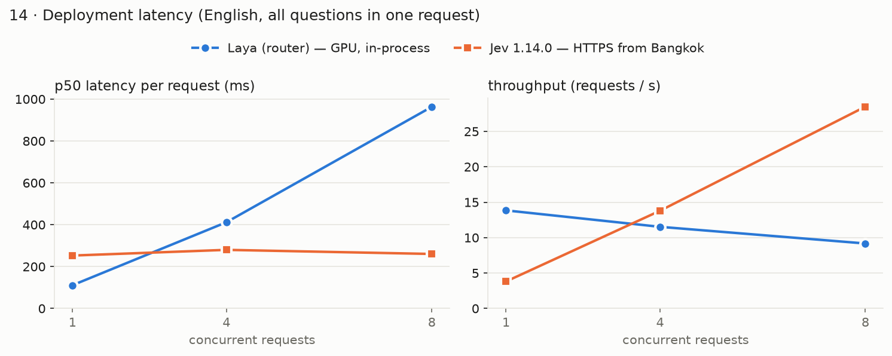

| Topology | p50 per request (all questions) | Scales with concurrency? |
|---|---|---|
| Laya, in-process, RTX 3060 Laptop GPU | 66–111 ms | No: 13.8 → 9.2 req/s at concurrency 1 → 8 |
| Laya, in-process, 8-thread CPU (WSL2) | 1.7–4.0 s | No |
| Jev, HTTPS from Bangkok (network round trip ≈ 205 ms) | 251–280 ms | Yes: 3.8 → 28.5 req/s |

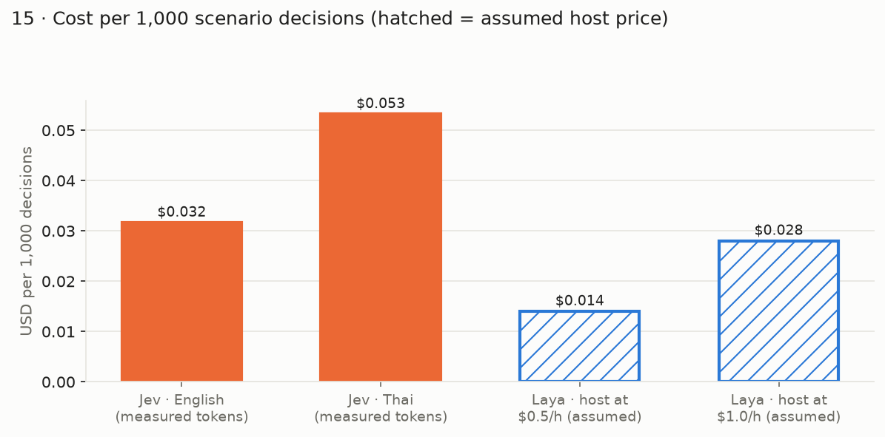

The whole study spent **USD 0.50** on Jev (11,384 requests at USD 0.042 per million input tokens).
Thai requests use about 2× the tokens of English. Laya has no API fee, but its host has to be paid
for. The hatched bars use explicitly *assumed* hourly prices.

Per-question tables, calibration parameters, P9 slices and the rules-vs-model breakdown are in
[`docs/FINAL_REPORT.md`](docs/FINAL_REPORT.md). Twelve paired EN/TH failure cases, with the clue each
model missed, are in [`docs/FAILURE_CASES.md`](docs/FAILURE_CASES.md).

---

## Reproduce the results

### Prerequisites

- Linux or WSL2, Python 3.12, [uv](https://docs.astral.sh/uv/), Java 21.
  OpenSearch bundles its own JDK, Neo4j needs Java 21.
- About 6 GB RAM and 10 GB disk. The first build downloads OpenSearch (1 GB), Neo4j (150 MB) and the
  Laya weights (1.5 GB).
- An NVIDIA GPU is optional but strongly recommended. `DEVICE=cpu` works, but the Laya runs then take
  many hours.
- Docker is **not** required: E01/E04 run from official tarballs (`infra/native/`) and the other
  engines run embedded. With Docker you can use the pinned `infra/compose.yaml` instead
  (`make db-up CASE=e01 DOCKER=1`).
- Only for the Jev track: a TypeSafe API key. Expect about USD 0.50 of usage.

### Setup

```bash
git clone <this-repo-url> de-jev && cd de-jev
cp .env.example .env      # fill the five *_PASSWORD values (local, throwaway)
                          # Jev track: TYPESAFE_API_KEY=... and ALLOW_REMOTE_API=1
make setup                # uv sync into ~/.venvs/de-jev (outside /mnt for speed on WSL)
make doctor               # writes results/hardware.json; secrets are reported as booleans only
make test                 # offline unit tests, no DB, model or network needed
```

> If your shell profile exports a different `TYPESAFE_API_KEY`, the value in `.env` still wins and
> the run manifest records that the shell variable was ignored.

### Run everything

```bash
make reproduce            # = bash scripts/reproduce.sh all
```

Or one step at a time. Every step is resumable, so if one is interrupted, run it again.

| Step | Command | What it does | Time (RTX 3060) |
|---|---|---|---|
| data | `make reproduce STEP=data` | Builds all 6 cases × 2 context levels against the real engines, verifies gold, and checks the result matches `configs/prompts/FROZEN.json` | ~15 min |
| pilot | `make reproduce STEP=pilot` | Rules, Laya and Jev on 20 dev pairs per case | ~5 min |
| laya | `make reproduce STEP=laya` | Rules + Laya on test and calibration, then P4, P5 and P7 | ~1.5 h |
| jev | `make reproduce STEP=jev` | The same requests to Jev 1.14.0, under the spend and request caps. Skipped if remote calls are disabled | ~25 min, ~USD 0.50 |
| latency | `make reproduce STEP=latency` | P8 harness (GPU, CPU, remote). Run it with the host otherwise idle | ~1 h |
| report | `make reproduce STEP=report` | Analysis, `docs/FINAL_REPORT.md`, `docs/figures/` and `results/*.csv` | ~15 min |

Outputs:
- per-run predictions and manifests: `results/runs/<run>/`
- request ledger (hashes, tokens and USD only): `results/remote_ledger.jsonl`
- tables: `results/analysis/test/`
- figures: `docs/figures/`

Laya numbers should match closely on the same GPU. Jev is a remote service, so small drifts are
possible.

---

## Reproduce with the `claude` CLI (CLAUDE.md)

The repository ships a [`CLAUDE.md`](CLAUDE.md) that the `claude` command-line agent reads
automatically. It contains the hard rules (secrets, spend caps, frozen prompts, no invented numbers)
and a step-by-step **"reproduce the results"** playbook.

```bash
git clone <this-repo-url> de-jev && cd de-jev
cp .env.example .env      # fill the passwords (and the TypeSafe key if you want the Jev track)
claude "reproduce the results"
```

Following `CLAUDE.md`, the agent will:

1. Check the environment (`make doctor`) and install dependencies if needed (`make setup`).
2. Stop and ask you to fill `.env` if it is missing. It never reads or prints secret values.
3. Run `make test`, then `make reproduce` step by step, fixing and resuming any step that fails.
4. Stop if the rebuilt data or prompts differ from `configs/prompts/FROZEN.json`. It never re-freezes
   or edits prompts.
5. Skip the Jev steps, and say so, if remote calls are disabled. It never raises the spend caps.
6. Compare the regenerated `docs/FINAL_REPORT.md` and `results/summary.csv` with the committed
   versions. It flags any primary macro-F1 change above 0.02 and any verdict change, and reports the
   Jev spend from the ledger.

You can also ask for a single step, for example `claude "rerun only the report step and update
the figures"`.

---

## Repository layout

```
PLAN.md                 study contract (research questions, protocols, stop conditions)
CLAUDE.md               agent rules and the "reproduce the results" playbook
Makefile                setup, doctor, generate, pilot, evaluate, analyze, report, figures, reproduce
scripts/reproduce.sh    the full study in resumable steps
configs/                study.yaml, models.yaml (pinned revisions), experiments.yaml,
                        prompts/e01..e06.yaml (EN/TH questions) + FROZEN.json
infra/                  compose.yaml (pinned digests), native/ engine scripts, init/ DDL, Cypher, dictionaries
src/debench/
  dataset/              e01..e06 generators, build orchestrator, pairing and splits
  evidence/             opensearch, clickhouse, postgres_schema, neo4j_lineage, postgres_pii, duckdb_sql
  providers/            laya_provider, jev_provider (budget, retries, version check), mock (CI only)
  eval/                 metrics, calibration, paired bootstrap, robustness, latency, cost
  runner.py             identical requests to every track, resumable, manifests
  analyze.py report.py figures.py latency_bench.py sql_guard.py payload.py normalize.py
tests/                  contracts, leakage, EN/TH pairing, DB ground truth, SQL guard, no-real-PII, metrics
docs/                   FINAL_REPORT, DATASET_CARD, MODEL_CARD_SNAPSHOTS, STUDY_LIMITATIONS, FAILURE_CASES, figures/
results/                summaries, ledger, hardware, latency, BLOCKERS.md (run logs are git-ignored)
```

## Limitations

- **All data is synthetic.** Gold labels are deterministic policies over database-verified facts,
  which is why the rules baselines are strong.
- **Thai has not been reviewed by a native speaker yet.**
- **Prompts were frozen without tuning** for either model.
- **Jev ran 2 option-order permutations** instead of 5, because of the 12,000-request cap.
- **Latency is a deployment comparison** on one laptop.

The full list is in [`docs/STUDY_LIMITATIONS.md`](docs/STUDY_LIMITATIONS.md); incidents and fixes
are in [`results/BLOCKERS.md`](results/BLOCKERS.md).
